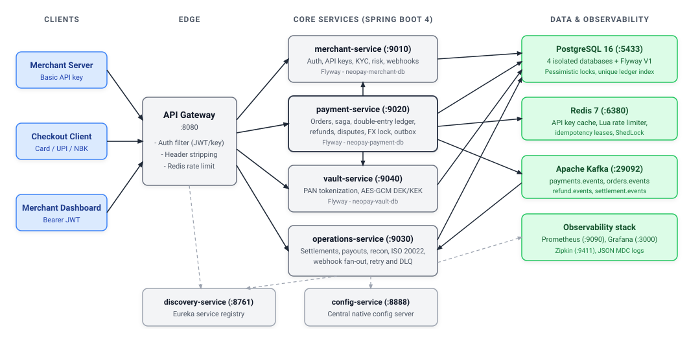

# NeoPay  -  Microservices Payments Platform

[](https://github.com/Snehal-Pradhan/NeoPay/actions/workflows/ci.yml)

> **Schema:** Flyway owns the schema. `V1__baseline.sql` in each database-backed service
> creates the tables, and Hibernate runs with `ddl-auto: validate`. Existing databases
> baseline at version 1; the `version` column from `BaseEntity` is part of the baseline.
>
> **Status:** all eight projects are published and verified. CI runs a matrix over
> every project, builds container images, validates Kubernetes manifests, and executes
> the full payment lifecycle end to end.

A Spring Boot 4 / Java 21 payments platform: API gateway, service discovery, central configuration, a shared library, and four independently deployable business services (merchant, payment, vault, operations).


## Lineage

This project began as an extension of a public teaching reference implementation.
The domain shape (five services, gateway, config and discovery) comes from that
reference. Everything below that line is this repository's own work:

- the double-entry ledger model and `PaymentAggregate` invariants
- the event store, snapshots and upcasting
- the deterministic 10M-transaction simulator and its proof harness
- the idempotency layering (database index plus Redis marker)
- CI-grade quality gates: ArchUnit, PMD, SpotBugs, ErrorProne, PIT, JaCoCo
- the ADR set, runbooks, postmortems, C4 views and performance work

Packages use the `com.snehal.neopay` namespace throughout.

## Architecture

<p align="center"></p>

```text
                         ┌──────────────────────┐
                         │    API Gateway :8080 │
                         │  auth, routes, rate  │
                         └──────────┬───────────┘
                                    │
        ┌───────────────┬───────────┼────────────┬────────────────┐
        ▼               ▼           ▼            ▼                ▼
  merchant-service  payment-service  vault-service  operations-service
      :9010             :9020           :9040            :9030
        │                 │               │                │
  merchant DB        payment DB       vault DB       operations DB
        └─────────────────┴───────────────┴────────────────┘
                                    │
                     PostgreSQL · Redis · Kafka · Zipkin

  discovery-service :8761   (Eureka)
  config-service    :8888   (Spring Cloud Config, native local repo)
  common-lib                (shared DTOs, enums, security, errors,
                             rate limiting, idempotency, Kafka, Zipkin)
```

### Service responsibilities

| Service | Port | Database | Responsibility |
|---|---:|---|---|
| `api-gateway-service` | 8080 |  -  | Routing, Basic API-key auth, JWT auth, identity headers, rate limiting |
| `merchant-service` | 9010 | `neopay-merchant-db` | Signup/login, API keys, customers, webhook configs, internal lookups |
| `payment-service` | 9020 | `neopay-payment-db` | Orders, payments, idempotency, compensation, gateway/processor routing, outbox, simulator |
| `vault-service` | 9040 | `neopay-vault-db` | PAN tokenization, AES-GCM envelope encryption, token charging |
| `operations-service` | 9030 | `neopay-operations-db` | Settlements, bank transfers, webhook fan-out/retry/DLQ, its own outbox |
| `config-service` | 8888 |  -  | Spring Cloud Config Server using the bundled native config repo |
| `discovery-service` | 8761 |  -  | Eureka service registry |
| `common-lib` |  -  |  -  | Shared types and auto-configuration |

## Prerequisites

- Java 21
- Maven 3.10+
- Docker / Docker Desktop

## Run locally

```bash
# 1. Infrastructure (Postgres on 5433, Redis on 6380, Kafka on 29092, Zipkin on 9411)
docker compose up -d

# 2. Build common-lib and all services
./build-all.sh

# 3. Start discovery/config/services/gateway
./scripts/run-local.sh

# 4. Stop the application processes
./scripts/stop-local.sh

# 5. Stop infrastructure
docker compose down -v
```

The local ports differ from the service defaults because a local Postgres/Redis may already use `5432`/`6379`. `scripts/run-local.sh` exports the matching overrides automatically.

Health:

```bash
curl http://localhost:8888/actuator/health
curl http://localhost:8761/eureka/apps
curl http://localhost:8080/actuator/health
```

## Containers, Kubernetes and observability

```bash
# container image for one service (no registry required)
mvn -f payment-service/pom.xml -DskipTests -Djib.skip=false \
  jib:buildTar -Djib.to.image=neopay/payment-service:local

# render and apply the Kubernetes stack to a local cluster
kubectl kustomize k8s | kubectl apply -f -

# Prometheus on 9090 and Grafana on 3000 with the NeoPay overview dashboard
docker compose -f docker-compose.yml -f observability/docker-compose.yml up -d
```

Images run as `1000:1000` with a read-only root filesystem; manifests carry startup,
readiness and liveness probes, resource limits, and NetworkPolicies with
default-deny ingress. CI validates the rendered manifests with kubeconform and a Trivy
misconfiguration scan on every push.

## Configuration

The Config Server uses the **native** profile and serves YAML from:

```text
config-service/src/main/resources/config/
├── application.yml
├── api-gateway-service.yml
├── merchant-service.yml
├── payment-service.yml
├── operations-service.yml
└── vault-service.yml
```

Services import it with `optional:configserver:${CONFIG_SERVER_URL:http://localhost:8888}`. This keeps the Pro architecture (central config + discovery + gateway) while avoiding the reference project's external GitHub config server and embedded credentials.

Production-style overrides are environment variables, including `JWT_SECRET`, `VAULT_MASTER_KEY`, `WEBHOOK_SECRET_ENCRYPTION_KEY`, per-service DB URLs/passwords, `REDIS_HOST/PORT`, and `KAFKA_BROKERS`.

## API surface (through the gateway)

| Method | Path | Service |
|---|---|---|
| POST | `/v1/auth/signup`, `/v1/auth/login` | merchant |
| POST/GET | `/v1/merchants/api-keys` | merchant |
| DELETE | `/v1/merchants/api-keys/{keyId}` | merchant |
| POST | `/v1/merchants/api-keys/{keyId}/rotate` | merchant |
| POST/GET/PUT/DELETE | `/v1/merchants/webhooks/**` | merchant |
| POST | `/v1/orders` | payment |
| POST | `/v1/payments`, `/v1/payments/{id}/capture` | payment |
| POST | `/v1/vault/tokenize` | vault |

## Tests

```bash
./scripts/test-all.sh          # unit suites, six projects in parallel (~2.5 min)
./scripts/test-all.sh --full   # every suite, serial (~6.5 min)
./scripts/verify-all.sh        # full gate: tests, static analysis, coverage check
```

| Project | Tests | Line | Branch | Mutation (PIT) |
|---|---:|---:|---:|---:|
| `common-lib` | 140 | 84.4% | 78.0% | 76% |
| `merchant-service` | 89 | 100.0% | 98.1% | 99% |
| `payment-service` | 153 | 85.5% | 69.9% | 76% |
| `vault-service` | 29 | 100.0% | 100.0% | 100% |
| `operations-service` | 79 | 88.9% | 83.6% | 73% |
| `api-gateway-service` | 38 | 87.8% | 77.3% | 80% |
| `discovery-service` | 1 | context load only |  -  |  -  |
| `config-service` | 1 | context load only |  -  |  -  |
| **Total** | **530** |  -  |  -  |  -  |

Test layers:

| Layer | Scope |
|---|---|
| Unit | services, domain, money, state machine, idempotency, rate limiting, gateway filters |
| Property | jqwik: money arithmetic, settlement fees, state machine sequences |
| Integration | Testcontainers Postgres and Redis, tagged `integration` |
| Concurrency | 50 threads on `(merchant_id, idempotency_key)`, refund races |
| Contract | OpenAPI document shape |
| Architecture | ArchUnit package and parameter budgets |
| End-to-end | seven-service stack over Compose in CI |

Quality gates enforced on `verify`:

| Gate | Tool |
|---|---|
| Package boundaries, no field injection, ≤5 parameters | ArchUnit |
| Cyclomatic complexity ≤10, ≤25 methods, ≤20 fields, coupling ≤20 | PMD |
| High and medium correctness defects | SpotBugs |
| Compiler-level correctness | ErrorProne |
| Source file length ≤300 lines | `scripts/complexity-budget.sh` |
| Bundle and per-layer line/branch floors | JaCoCo + `scripts/coverage-gate.py` |
| Mutation floors per module (73-100%) | PIT |

Thresholds are ratchets: they were raised after each test-hardening pass and are
never lowered. Full detail lives in `TESTING.md`.

## Performance

Measured end to end through the gateway on the local seven-service stack: 900 order+payment
flows (1,800 HTTP requests) at a constant 15 flows/sec for 60 seconds, spread across 20
separate merchant API keys.

| Metric | Measured | Threshold |
|---|---:|---:|
| Throughput | 30.0 req/s |  -  |
| Error rate | 0.00% (0/1,800) | < 1% |
| `POST /v1/orders` p95 | 80.9 ms | < 250 ms |
| `POST /v1/payments` p95 | 41.2 ms | < 350 ms |
| Overall p95 | 42.8 ms | < 300 ms |

Reproduce with `./perf/run-k6.sh` (provisions its own merchants and keys). Raw artifact:
`perf/k6-summary.json`. Method, limits and the service-level baseline: `docs/PERFORMANCE.md`.

## Deployment

`k8s/` contains the manifests (namespace, config map, default-deny network policies,
Postgres/Redis/Kafka/Zipkin/Prometheus/Grafana, and one Deployment per service) plus a
`kind` cluster definition. CI validates the rendered manifests with `kubeconform` and
Trivy, then a `kind smoke` job builds a real Jib image, loads it into a single-node
cluster, deploys `config-service`, waits for the rollout, queries
`/actuator/health`, applies the network policies and uploads pod evidence as an
artifact. This is a deployment proof, not a production topology: no cloud resources,
ingress controller, TLS, or managed databases.

## Verified flows

Executed both locally and on every push by the `end-to-end` CI job, through the gateway:

- signup → login → create API key
- create order
- tokenize a card in vault
- initiate card payment (payment → vault over Feign/Eureka)
- scheduled bank callback → `CAPTURED` + order `PAID`
- payment idempotency (`X-Idempotency-Key` returns the same payment, one DB row)
- outbox → Kafka → operations webhook fan-out → receiver `200` (2-3 events delivered)
- ShedLock keys in Redis
- gateway 401 for invalid/revoked credentials and structured error envelopes

## Intentional differences from the Pro reference

- **Java 21** instead of Java 25 (current build environment); all sources compile.
- **Native Config Server** bundled with this repo instead of the public GitHub config repo.
- **Sanitized secrets**; the reference's hardcoded GitHub PAT and real-looking keys are not included.
- **Bug fixes**: response status mappings, revoke route, Kafka listener keys, `NETBANKING` binding, local merchant webhook-key typo, and a serializable vault-charge response.
- **Tests** added for every service context; the Pro reference only had empty context tests.
- Jib image publishing is opt-in (`-Djib.skip=false`) and points at neutral `neopay/...` image names.

## Documentation

| Document | Contents |
|---|---|
| `docs/index.md` | Master index: architecture, data, services, patterns, operations |
| `docs/API.md` | Versioning, RFC 9457 errors, pagination, idempotency |
| `docs/DESIGN.md` | Invariants, consistency model, failure modes, weak points |
| `docs/SIMULATION.md` | Deterministic 10M-transaction simulation and results |
| `docs/POSTMORTEM.md` | Six real defects: symptom, root cause, fix, prevention |
| `docs/runbook.md` | Symptom-first procedures: outbox, DLQ, Redis, Kafka, settlement, webhooks, disputes, pricing, config |
| `docs/c4/` | Context, container, and payment component diagrams |
| `docs/adr/` | Twelve architecture decision records |
| `docs/diagrams/` | SVG overview and eight Eraser.io service architecture definitions |
| `CONTRIBUTING.md` | Build, test, pull-request rules |
| `CHANGELOG.md` | Phase-by-phase history |

## Known gaps

- Internal endpoints are protected only by cluster networking. Service-level
  authentication (shared secret or mTLS) is not implemented.
- Wallet payments have no adapter or processor.
- Settlement uses one global fee schedule; per-merchant pricing is not wired.
- `Payment`, `OrderRecord` and `Settlement` remain the persistence projection. The
  aggregate is not yet the write path, and entity setters still exist.
- Kafka header trace propagation is not asserted by a test.
- `common-lib` infrastructure coverage is 82.0% / 77.8%; the remaining gap is
  auto-configuration wiring, which is exercised indirectly rather than directly.
- Cloud infrastructure, GitOps and SRE practice are out of scope for the current
  milestone: no Terraform, no ArgoCD, no SLOs, no chaos runs yet.
