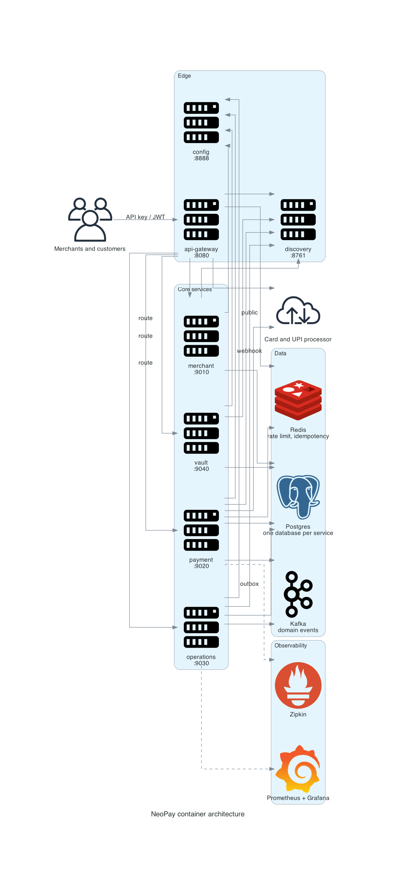

# Container architecture

Seven Spring Boot services run as separate JVMs. Four own data, three provide edge and platform functions. Services communicate over HTTP with discovery, or asynchronously through Kafka.

<p align="center"></p>

Diagram source: `docs/assets/scripts/00_container_architecture.py`.

## Containers

| Container | Port | Responsibility | Data store |
|---|---:|---|---|
| `api-gateway-service` | 8080 | Routing, API key and JWT validation, rate limiting, idempotency filter | Redis |
| `discovery-service` | 8761 | Eureka registry | none |
| `config-service` | 8888 | Native configuration server | classpath `config/` |
| `merchant-service` | 9010 | Merchants, users, API keys, KYC, limits, merchant webhook configuration | Postgres |
| `payment-service` | 9020 | Orders, payments, refunds, disputes, ledger, outbox, inbound PSP webhooks | Postgres |
| `operations-service` | 9030 | Settlement, payouts, reconciliation, merchant webhook delivery | Postgres |
| `vault-service` | 9040 | Card tokenization and detokenization | Postgres |

## Synchronous paths

| Caller | Callee | Purpose |
|---|---|---|
| gateway | any service | Route by path prefix |
| payment | merchant | Risk limits and merchant status |
| payment | vault | Detokenize for a card charge |
| operations | payment | Unsettled captured payments; ledger postings; mark settled |
| operations | merchant | Settlement bank details; active merchant list |
| gateway | merchant | API key lookup, cached in Redis |

## Asynchronous paths

| Producer | Topic | Consumer |
|---|---|---|
| payment outbox | `payments.events`, `orders.events`, `refunds.events` | operations webhook fan-out |
| operations outbox | `settlements.events` | operations webhook fan-out |
| operations | merchant webhook URL | merchant backend, signed |

Topic defaults are declared in `operations-service/src/main/java/com/snehal/neopay/operations/webhook/WebhookKafkaConsumer.java`.

## Why this shape

| Decision | Reason | Reference |
|---|---|---|
| Gateway terminates merchant authentication | One place to enforce key and JWT rules | [api_gateway](../02_services/api_gateway.md) |
| Four services own money state | Bounded contexts around order, payment, settlement, card data | [service map](../02_services/overview.md) |
| Kafka only for fan-out | No service depends on Kafka for its write path | [outbox pattern](../03_patterns/02_transactional_outbox.md) |
| Config server instead of environment sprawl | One file per service per profile | [config service](../02_services/config_service.md) |

## Deployment shape

Local development runs jars directly (`scripts/run-local.sh`). CI builds Jib images and deploys `config-service` to a `kind` cluster to prove image and manifest correctness. The topology below production scale is not part of this repository.

Related: [system context](01_system_context.md), [deployment](../04_operations/02_deployment_and_hpa.md).

## Diagram script

```python
import os
import sys

sys.path.insert(0, os.path.dirname(__file__))
from _style import GRAPH_ATTR, NODE_ATTR, EDGE_ATTR, node

from diagrams import Diagram, Edge
from diagrams.onprem.client import Users
from diagrams.onprem.compute import Server
from diagrams.onprem.database import PostgreSQL
from diagrams.onprem.inmemory import Redis
from diagrams.onprem.network import Internet
from diagrams.onprem.queue import Kafka

G = dict(GRAPH_ATTR)
G.update({"nodesep": "0.45", "ranksep": "0.9", "splines": "polyline"})

with Diagram("", show=False, direction="LR", graph_attr=G,
             node_attr=NODE_ATTR, edge_attr=EDGE_ATTR,
             filename="./docs/assets/00_container_architecture", outformat="png"):
    users = node(Users, "Merchants")
    psp = node(Internet, "PSP")
    gateway = node(Server, "gateway")
    merchant = node(Server, "merchant")
    payment = node(Server, "payment")
    operations = node(Server, "operations")
    vault = node(Server, "vault")
    db = node(PostgreSQL, "Postgres")
    cache = node(Redis, "Redis")
    bus = node(Kafka, "Kafka")

    users >> Edge(label="API key") >> gateway
    psp >> Edge(label="webhook") >> gateway
    gateway >> merchant
    gateway >> payment
    gateway >> operations
    gateway >> vault
    merchant >> db
    payment >> db
    operations >> db
    vault >> db
    gateway >> cache
    payment >> Edge(label="outbox") >> bus
```
