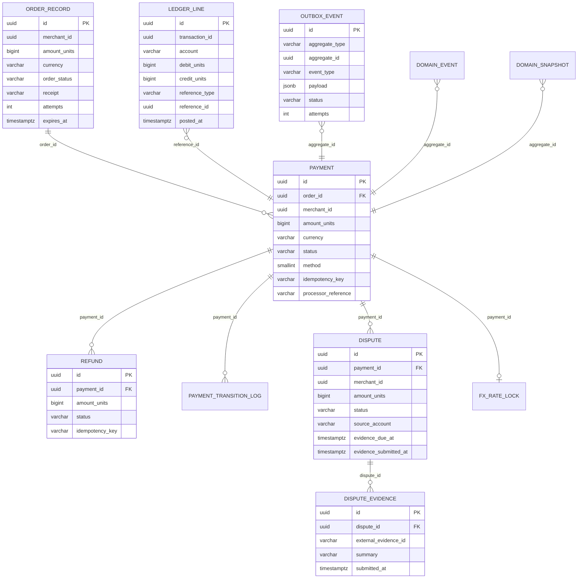

# ER diagram and schema

Schemas are owned per service. The diagram shows the payment database in full and the other three databases by their principal tables.

Diagram source of truth: `payment-service/src/main/resources/db/migration/V1__baseline.sql` and `V2`, `V3`, `V4`.

## Keys and constraints that carry behaviour

| Table | Constraint | Behaviour it enforces |
|---|---|---|
| `order_record` | unique `(merchant_id, receipt)` | a merchant cannot reuse a receipt |
| `payment` | unique `(merchant_id, idempotency_key)` | one payment per key per merchant |
| `refund` | unique `(payment_id, idempotency_key)` | one refund per key per payment |
| `ledger_line` | unique `(transaction_id, account)` | replay of a posting is a no-op |
| `domain_event` | unique `(aggregate_id, sequence_number)` | append-only ordering per aggregate |
| `webhook_event` | unique `(provider, external_event_id)` | inbound PSP replay guard |
| `dispute_evidence` | unique `(dispute_id, external_evidence_id)` | idempotent evidence upload |
| `reserve_release` | unique `(source_line_id)` | a reserve is released once |

## Other databases

| Database | Principal tables | Owner |
|---|---|---|
| `neopay-merchant-db` | `merchant`, `app_user`, `api_key`, `customer`, `merchant_webhook_config`, `merchant_limit_usage` | merchant-service |
| `neopay-operations-db` | `settlement`, `settlement_payment`, `payout`, `recon_run`, `recon_break`, `dlq_event`, `webhook_event` | operations-service |
| `neopay-vault-db` | `vault_card`, `card_token` | vault-service |

## Schema rules

| Rule | Reason |
|---|---|
| Money is stored as integer minor units plus a currency code | No floating point in any money path |
| State machines store the enum name, not the ordinal | `payment.status` is `varchar(30)`; `payment.method` is `smallint` |
| Every state change writes `payment_transition_log` | Audit and event replay |
| Ledger rows are never updated or deleted | Append-only posting |
| Timestamps are `timestamp without time zone` in the baseline | The application supplies UTC values |

## Known schema weaknesses

| Weakness | Effect |
|---|---|
| `payment.method` is an ordinal `smallint` | Reordering the enum would corrupt meaning |
| No check constraint on `payment.amount_units > 0` | Validation is application-level only |
| `ledger_line` has no partitioning | Aggregates scan the whole table, see [DB_VOLUME](../DB_VOLUME.md) |
| `webhook_event` has no retention policy | Table grows without bound |

Related: [storage architecture](02_storage_architecture.md), [isolation and tenancy](03_isolation_and_tenancy.md).
