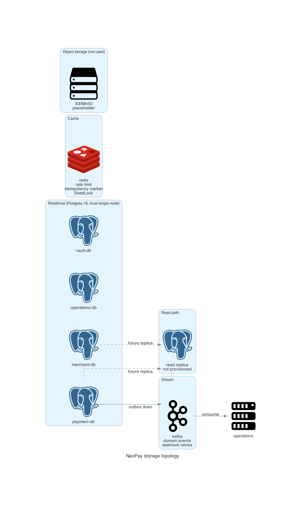

# Storage architecture

Each service owns one Postgres database. Redis holds only ephemeral control state. Kafka holds events in flight. No object store is used.



Diagram source: `docs/assets/scripts/01_storage_architecture.py`.

## Store roles

| Store | Data | Durability requirement | Loss impact |
|---|---|---|---|
| Postgres, four databases | Money state, ledger, settlements, tokens | High | Payment writes fail; no silent corruption |
| Redis | Rate-limit counters, idempotency in-progress markers, ShedLock leases, API-key cache | Low | Limiter fails open, jobs pause, keys reload from Postgres |
| Kafka | Domain events for webhook fan-out | Medium | Delivery delays; outbox retains events |
| Object storage | none | Not used | Not applicable |

## Why four databases instead of one

| Reason | Consequence |
|---|---|
| No cross-service transaction is possible, so boundaries are explicit | Settlement calls payment over HTTP and compensates on failure |
| A schema change in one service cannot break another | Migrations run per service |
| Backup and restore are per domain | Restore order matters: merchant, payment, operations, vault |

Cost: cross-domain reporting needs API calls or a data warehouse, which this repository does not have.

## Connection and pool configuration

| Setting | Value | Source |
|---|---|---|
| Pool | HikariCP default | Spring Boot |
| Max connections (server) | 300 | `docker-compose.yml` |
| Per-service URL | `jdbc:postgresql://localhost:5433/<db>` | `scripts/run-local.sh` |
| Migrations | Flyway on startup | module POMs |

## Redis key usage

| Key family | Owner | TTL |
|---|---|---|
| Idempotency placeholder | `IdempotencyFilter` | 120 s in progress, 24 h completed |
| Rate-limit counters | gateway limiter | one window |
| ShedLock leases | scheduled jobs | `lockAtMostFor` per job |
| API key cache | gateway | configuration-defined |

## What is not present

| Capability | Status |
|---|---|
| Read replica | Not provisioned; the storage diagram marks it as future |
| Connection pooling proxy (PgBouncer) | Not used |
| Object storage for statements or evidence | Not used; reports are generated on demand |
| Vector database | Not applicable to this domain |

Related: [ER diagram](01_er_diagram_and_schema.md), [sharding and backups](04_sharding_and_backups.md).

## Diagram script

```python
from diagrams import Diagram, Cluster, Edge
from diagrams.onprem.database import PostgreSQL
from diagrams.onprem.inmemory import Redis
from diagrams.onprem.queue import Kafka
from diagrams.onprem.compute import Server
from diagrams.generic.storage import Storage

with Diagram("NeoPay storage topology", show=False, direction="LR",
             filename="./docs/assets/01_storage_architecture", outformat="png"):
    with Cluster("Relational (Postgres 16, local single node)"):
        merchant_db = PostgreSQL("merchant-db")
        payment_db = PostgreSQL("payment-db")
        operations_db = PostgreSQL("operations-db")
        vault_db = PostgreSQL("vault-db")

    with Cluster("Cache"):
        redis = Redis("redis\nrate limit\nidempotency marker\nShedLock")

    with Cluster("Stream"):
        kafka = Kafka("kafka\ndomain events\nwebhook retries")

    with Cluster("Object storage (not used)"):
        s3 = Storage("S3/MinIO\nplaceholder")

    with Cluster("Read path"):
        replica = PostgreSQL("read replica\nnot provisioned")

    merchant_db >> Edge(style="dashed", label="future replica") >> replica
    payment_db >> Edge(style="dashed", label="future replica") >> replica
    payment_db >> Edge(label="outbox drain") >> kafka
    kafka >> Edge(label="consume") >> Server("operations")
```
