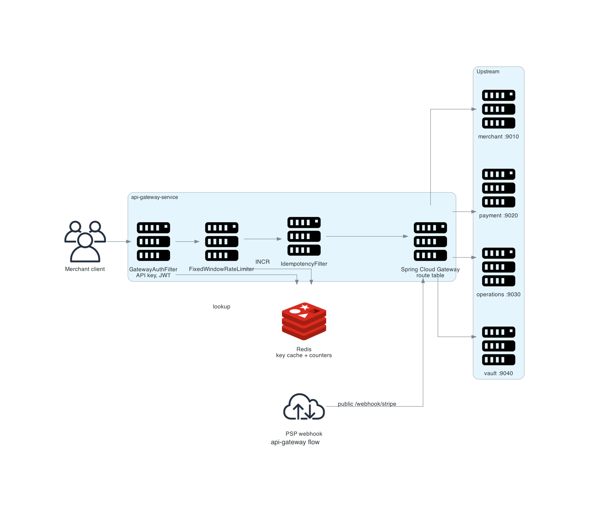

# api-gateway-service

The only public entry point. It authenticates merchants, throttles them, applies the idempotency filter, and routes to one of four services.



## Scope

| In scope | Out of scope |
|---|---|
| API key and JWT validation | Issuing tokens |
| Per-key rate limiting | Domain-level idempotency |
| Route selection | Response transformation |
| Correlation and trace propagation | Retries of upstream calls |

Entry point: `api-gateway-service/src/main/java/com/snehal/neopay/gateway/`.

## Request pipeline

| Order | Component | Behaviour |
|---:|---|---|
| 1 | `GatewayAuthFilter` | Skips public routes; otherwise validates the Authorization header |
| 2 | `FixedWindowRateLimiter` | Counts requests per key per minute in Redis |
| 3 | `IdempotencyFilter` | Present only when `X-Idempotency-Key` is sent; stores the response for replay |
| 4 | Route table | Path prefix to `lb://<service>` |

## API

The gateway exposes no API of its own. It forwards:

| Path | Upstream |
|---|---|
| `/v1/auth/**`, `/v1/merchants/**` | merchant |
| `/v1/orders/**`, `/v1/payments/**` | payment |
| `/v1/vault/**` | vault |
| `/webhook/stripe` | payment |
| `/webhook/**` | operations |

## Configuration

| Key | Default | Meaning |
|---|---|---|
| `app.security.public-routes` | `/v1/auth/**`, `/webhook/**`, `/actuator/**` | Paths that bypass authentication |
| `app.security.trust-inbound-headers` | `false` | Whether identity headers from outside are trusted |
| `app.rate-limit.use-case.api-key.requests-per-minute` | 200 | Fixed-window limit per key |

Source: `config-service/src/main/resources/config/api-gateway-service.yml`.

## Failure modes

| Condition | Response | Notes |
|---|---|---|
| Missing or invalid credentials | `401 UNAUTHORIZED` | Detail names the header, not the key |
| Limit exceeded | `429 RATE_LIMIT_EXCEEDED` | Fixed window; bursts inside one window can exceed the per-minute average |
| Redis unavailable | Request passes through | Limiter and replay cache fail open |
| Upstream unavailable | `503` from the route | No retry |
| Duplicate key in progress | `409 IDEMPOTENCY_CONFLICT` | 120 s placeholder TTL |

The 200-per-minute limit produced 0.11% `429` responses at 60 flows/s with 60 keys. Measurement: [PERFORMANCE](../PERFORMANCE.md).

## Diagram script

```python
from diagrams import Diagram, Cluster, Edge
from diagrams.onprem.client import Users
from diagrams.onprem.network import Internet
from diagrams.onprem.compute import Server
from diagrams.onprem.inmemory import Redis

with Diagram("api-gateway flow", show=False, direction="LR",
             filename="./docs/assets/service_api_gateway_flow", outformat="png"):
    client = Users("Merchant client")
    with Cluster("api-gateway-service"):
        auth = Server("GatewayAuthFilter\nAPI key, JWT")
        limit = Server("FixedWindowRateLimiter")
        idem = Server("IdempotencyFilter")
        router = Server("Spring Cloud Gateway\nroute table")
    cache = Redis("Redis\nkey cache + counters")
    with Cluster("Upstream"):
        merchant = Server("merchant :9010")
        payment = Server("payment :9020")
        operations = Server("operations :9030")
        vault = Server("vault :9040")
    psp = Internet("PSP webhook")

    client >> auth >> limit >> idem >> router
    auth >> Edge(label="lookup") >> cache
    limit >> Edge(label="INCR") >> cache
    router >> merchant
    router >> payment
    router >> operations
    router >> vault
    psp >> Edge(label="public /webhook/stripe") >> router
```

Related: [service map](overview.md), [idempotency](../03_patterns/03_idempotency.md), [resilience](../03_patterns/04_resilience_circuit_breakers.md).
