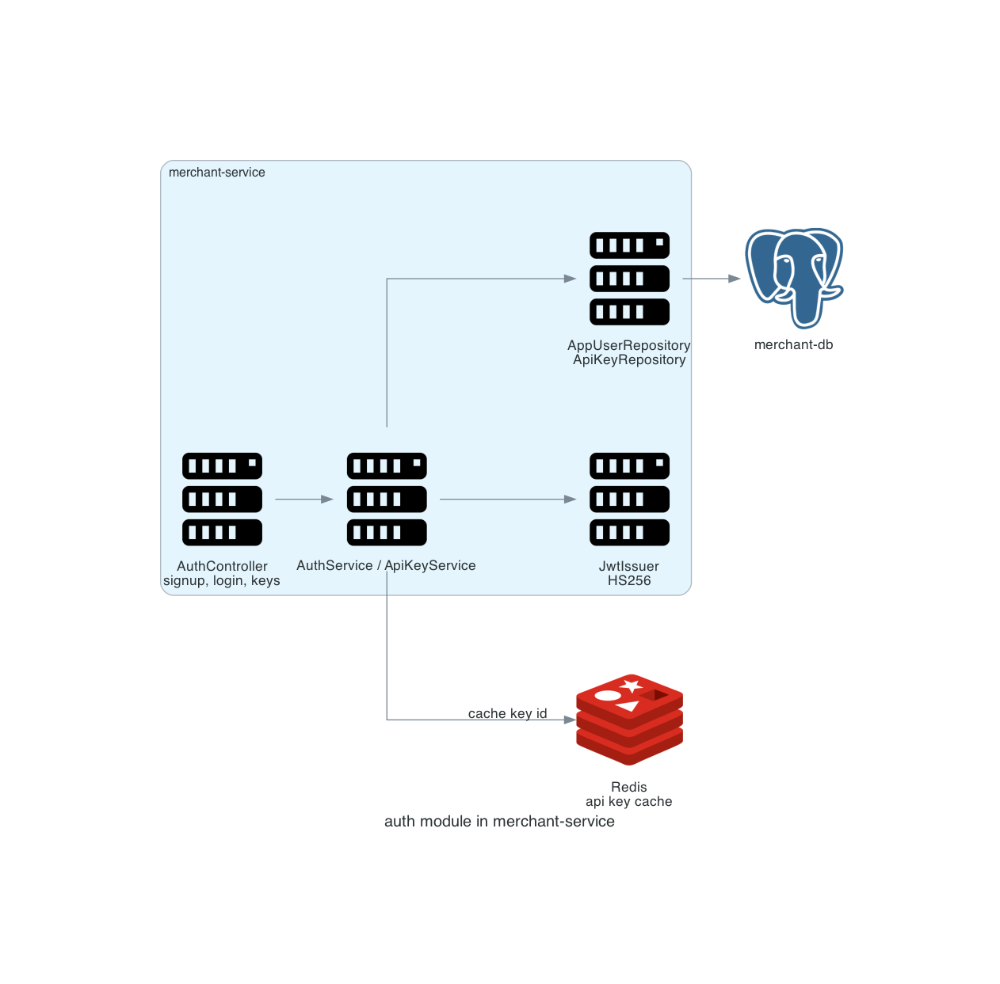

# auth module (merchant-service)

Merchants sign up, verify KYC, log in, and create API keys here. The module runs inside `merchant-service`; there is no separate auth deployment.



## Scope

| In scope | Out of scope |
|---|---|
| Merchant signup and login | Customer-facing identity |
| JWT issuance and validation | OAuth, social login, MFA |
| API key creation and revocation | Key rotation policy |
| Role checks for merchant users | Fine-grained permissions |

Entry point: `merchant-service/src/main/java/com/snehal/neopay/merchant/`.

## API

| Method and path | Purpose | Auth |
|---|---|---|
| `POST /v1/auth/signup` | Create merchant and owner user | Public |
| `POST /v1/auth/login` | Exchange credentials for a JWT | Public |
| `POST /v1/merchants/api-keys` | Create a `TEST` or `LIVE` key pair | JWT |
| `GET /v1/merchants/api-keys` | List keys, secrets masked | JWT |
| `POST /internal/kyc/{merchantId}/verify` | Mark KYC verified | Cluster only |
| `POST /internal/kyc/{merchantId}/tier` | Set risk tier | Cluster only |

## Credentials

| Credential | Format | Storage |
|---|---|---|
| Password | BCrypt hash | `app_user.password_hash` |
| JWT | HS256, shared secret from config | Stateless |
| API key id | `key_...` prefix by environment | `api_key.key_id` |
| API key secret | Hashed with BCrypt | `api_key.secret_hash` |

The gateway caches key lookups in Redis and falls back to a database read when Redis is unavailable.

## Failure modes

| Condition | Response |
|---|---|
| Duplicate email | `409 DUPLICATE_RESOURCE` |
| Wrong password | `401 UNAUTHORIZED` with a generic detail |
| Unknown key id | `401 UNAUTHORIZED` |
| Key revoked | `401 UNAUTHORIZED` |
| Merchant not KYC verified | `403` on payment creation, raised by the risk check |

## Diagram script

```python
from diagrams import Diagram, Cluster, Edge
from diagrams.onprem.compute import Server
from diagrams.onprem.database import PostgreSQL
from diagrams.onprem.inmemory import Redis

with Diagram("auth module in merchant-service", show=False, direction="LR",
             filename="./docs/assets/service_auth_flow", outformat="png"):
    with Cluster("merchant-service"):
        controller = Server("AuthController\nsignup, login, keys")
        service = Server("AuthService / ApiKeyService")
        jwt = Server("JwtIssuer\nHS256")
        repo = Server("AppUserRepository\nApiKeyRepository")
    db = PostgreSQL("merchant-db")
    cache = Redis("Redis\napi key cache")

    controller >> service
    service >> jwt
    service >> repo >> db
    service >> Edge(label="cache key id") >> cache
```

Related: [api gateway](api_gateway.md), [merchant service](merchant_service.md).
