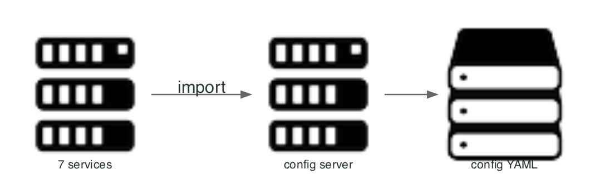

# config-service

Serves per-service, per-profile YAML from the classpath. Services import it at startup with `spring.config.import`.



## Scope

| In scope | Out of scope |
|---|---|
| Configuration files for seven services | Secret storage |
| Profile overlays (`k8s`, `test`) | Dynamic refresh |
| Central defaults for URLs, limits, resilience | Feature flags |

Entry point: `config-service/src/main/resources/config/`.

## Layout

| File | Owner |
|---|---|
| `config/application.yml` | Shared defaults |
| `config/merchant-service.yml` | Merchant service |
| `config/payment-service.yml` | Payment service |
| `config/operations-service.yml` | Operations service |
| `config/vault-service.yml` | Vault service |
| `config/api-gateway-service.yml` | Gateway routes, public paths, limits |

## Consumption

```yaml
spring:
  config:
    import: optional:configserver:${CONFIG_SERVER_URL:http://localhost:8888}
```

`optional:` means a service starts with local defaults when the config server is unreachable. `SPRING_CLOUD_CONFIG_FAIL_FAST` controls strictness in the cluster.

## Profiles

| Profile | Effect |
|---|---|
| default | Local URLs on `localhost` |
| `k8s` | Cluster DNS names, Eureka disabled for the config server itself |
| `test` | Disables config import, Flyway, and Eureka in tests |

## Failure modes

| Condition | Result |
|---|---|
| Config server slow | Retries with backoff, then starts with defaults |
| Malformed YAML | Startup fails; the file is validated by the service parsing it |
| Secret placed in YAML | Loaded as plain text; secrets belong in environment variables |

## Diagram script

```python
import os
import sys

sys.path.insert(0, os.path.join(os.path.dirname(__file__), ".."))
from _style import GRAPH_ATTR, NODE_ATTR, EDGE_ATTR, node

from diagrams import Diagram, Edge
from diagrams.onprem.compute import Server
from diagrams.generic.storage import Storage

G = dict(GRAPH_ATTR)
G.update({"splines": "polyline"})

with Diagram("", show=False, direction="LR", graph_attr=G,
             node_attr=NODE_ATTR, edge_attr=EDGE_ATTR,
             filename="./docs/assets/service_config_flow", outformat="png"):
    services = node(Server, "7 services")
    server = node(Server, "config server")
    files = node(Storage, "config YAML")

    services >> Edge(label="import") >> server >> files
```

Related: [ADR 0007](../adr/0007-native-config-server.md), [deployment](../04_operations/02_deployment_and_hpa.md).
