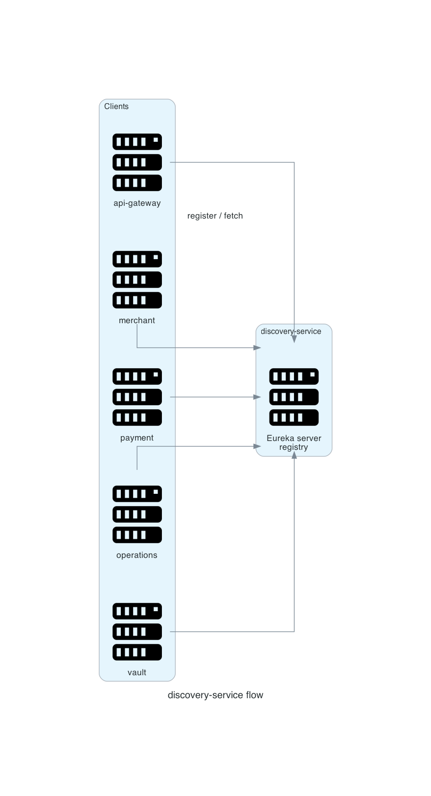

# discovery-service

Eureka registry. Services register on startup and resolve each other by service name.

<p align="center"></p>

## Scope

| In scope | Out of scope |
|---|---|
| Service registration | Load-balancer configuration |
| Registry reads for `lb://` routes | Health checking of business endpoints |
| Lease renewal | Cross-cluster federation |

## Behaviour

| Setting | Value |
|---|---|
| Port | 8761 |
| Registry | In-memory, not persisted |
| Self-registration | Disabled for the server |
| Client registration | Every service registers on startup |

Clients point at `EUREKA_URL`, default `http://localhost:8761/eureka/`.

## Failure modes

| Condition | Result |
|---|---|
| Registry restart | In-memory registry empties; clients re-register within one lease cycle |
| Stale instance | Gateway routes to a dead address until the lease expires; the request fails |
| Discovery down at startup | A client retries; a gateway route uses `lb://` and fails until registration succeeds |

For a local stack without discovery, `k8s` profile sets direct service URLs and disables Eureka.

## Diagram script

```python
import os
import sys

sys.path.insert(0, os.path.join(os.path.dirname(__file__), ".."))
from _style import GRAPH_ATTR, NODE_ATTR, EDGE_ATTR, node

from diagrams import Diagram, Edge
from diagrams.onprem.compute import Server

G = dict(GRAPH_ATTR)
G.update({"splines": "polyline"})

with Diagram("", show=False, direction="LR", graph_attr=G,
             node_attr=NODE_ATTR, edge_attr=EDGE_ATTR,
             filename="./docs/assets/service_discovery_flow", outformat="png"):
    gateway = node(Server, "gateway")
    merchant = node(Server, "merchant")
    payment = node(Server, "payment")
    operations = node(Server, "operations")
    vault = node(Server, "vault")
    registry = node(Server, "registry")

    gateway >> Edge(label="register") >> registry
    merchant >> Edge(constraint="false") >> registry
    payment >> Edge(constraint="false") >> registry
    operations >> Edge(constraint="false") >> registry
    vault >> Edge(constraint="false") >> registry
```

Related: [container architecture](../00_architecture/02_container_architecture.md).
