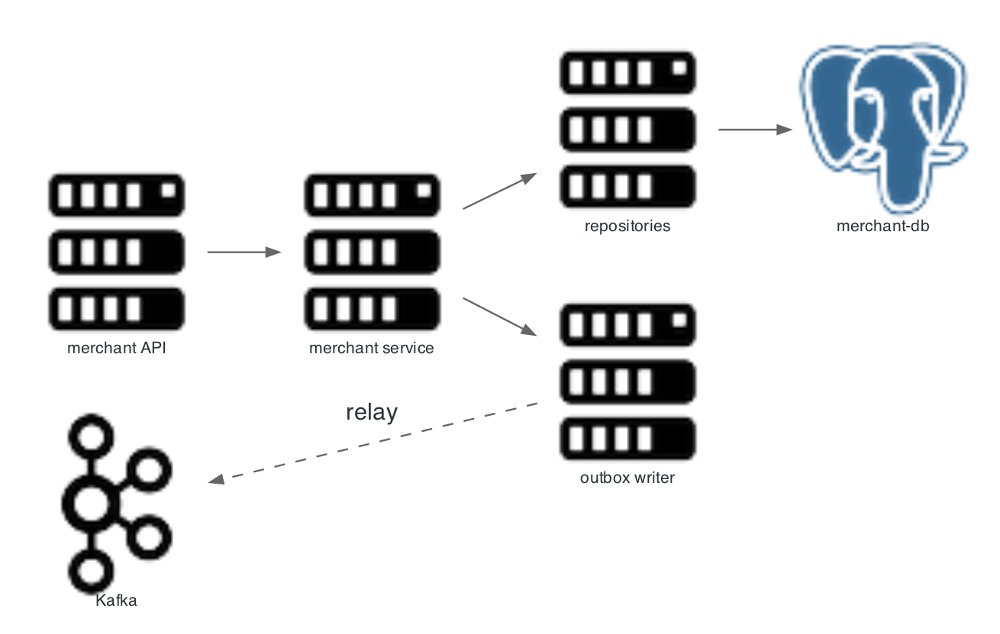

# merchant-service

Owns merchant identity, commercial profile, KYC state, risk limits, customers, and merchant webhook configuration. It is the authority other services consult for merchant status and bank details.



## Scope

| In scope | Out of scope |
|---|---|
| Merchant record and status | Authentication policy enforcement |
| API key metadata | Payment decisions |
| KYC verification state | Settlement execution |
| Risk tier and limit usage | Card data |
| Customer records | Ledger entries |
| Merchant webhook configuration | Webhook delivery |

Entry point: `merchant-service/src/main/java/com/snehal/neopay/merchant/`.

## API

| Method and path | Purpose |
|---|---|
| `POST /v1/merchants/api-keys` | Create a key pair |
| `GET /v1/merchants/api-keys` | List keys |
| `POST /v1/merchants/api-keys/{keyId}/rotate` | Rotate a key |
| `POST /v1/merchants/webhooks` | Register a delivery URL |
| `GET /v1/merchants/webhooks/{id}` | Read a registration |
| `GET /internal/merchants/active-ids` | Merchant ids for settlement |
| `GET /internal/merchants/{id}/settlement-bank-details` | Bank account and IFSC |
| `GET /internal/merchants/{id}/webhook-targets` | Delivery targets |
| `POST /internal/customers/find-or-create` | Resolve a customer |
| `GET /internal/api-keys/{keyId}` | Key lookup for the gateway |
| `POST /internal/kyc/{id}/verify` | Set KYC verified |
| `POST /internal/kyc/{id}/tier` | Set risk tier |
| `POST /internal/risk/authorize` | Risk decision for a payment |

## Internal flow

1. A write validates the request, loads or creates the entity, and saves it.
2. The write publishes an outbox event in the same transaction.
3. `OutboxPoller` drains `PENDING` rows to Kafka.
4. Read endpoints serve straight from the repository.

## Resilience

| Dependency | Failure behaviour |
|---|---|
| Postgres | Requests fail; no partial write |
| Kafka | Outbox grows; writes still commit |
| Redis | API key cache misses fall back to Postgres |

`RiskEnforcer` in `payment-service` treats this service as fail-open: an unavailable merchant service increments a counter and allows the payment.

## Error modes

| Condition | Response |
|---|---|
| Unknown merchant | `404 MERCHANT_NOT_FOUND` |
| Missing bank details at settlement | Settlement marked `FAILED` with a data reason |
| Inactive merchant | Payment initiation rejected by the risk check |

## Diagram script

```python
import os
import sys

sys.path.insert(0, os.path.join(os.path.dirname(__file__), ".."))
from _style import GRAPH_ATTR, NODE_ATTR, EDGE_ATTR, node

from diagrams import Diagram, Edge
from diagrams.onprem.compute import Server
from diagrams.onprem.database import PostgreSQL
from diagrams.onprem.queue import Kafka

G = dict(GRAPH_ATTR)
G.update({"splines": "polyline"})

with Diagram("", show=False, direction="LR", graph_attr=G,
             node_attr=NODE_ATTR, edge_attr=EDGE_ATTR,
             filename="./docs/assets/service_merchant_flow", outformat="png"):
    api = node(Server, "merchant API")
    svc = node(Server, "merchant service")
    repo = node(Server, "repositories")
    db = node(PostgreSQL, "merchant-db")
    outbox = node(Server, "outbox writer")
    bus = node(Kafka, "Kafka")

    api >> svc >> repo >> db
    svc >> outbox
    outbox >> Edge(label="relay", style="dashed", constraint="false") >> bus
```

Related: [auth module](auth_service.md), [service map](overview.md).
