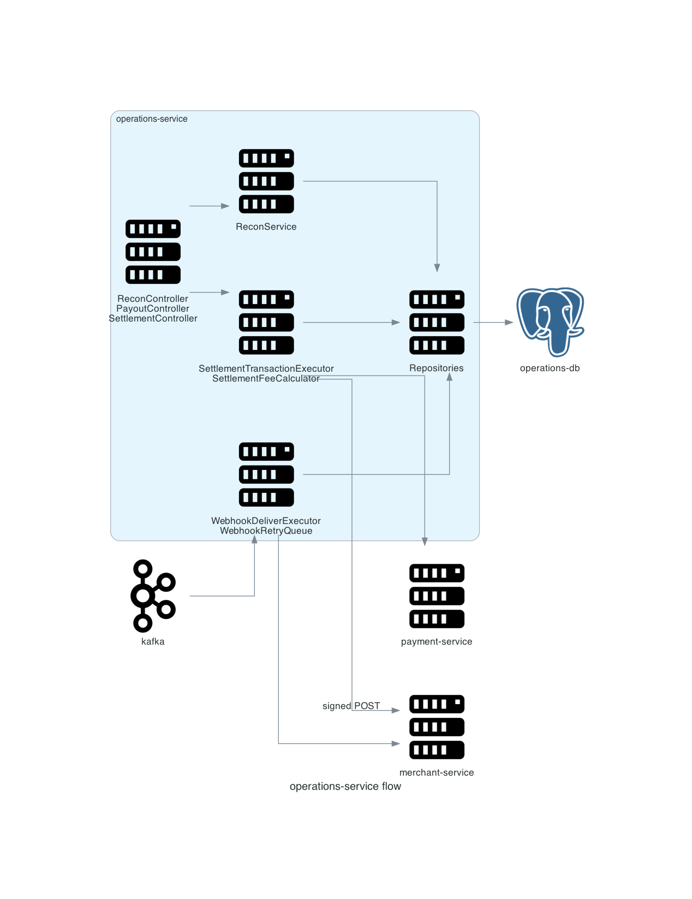

# operations-service

Runs everything that happens after capture: settlement, payouts, reconciliation, and delivery of merchant webhooks.



## Scope

| In scope | Out of scope |
|---|---|
| Settlement computation and persistence | Payment state transitions |
| Payout files and payout returns | Merchant authentication |
| Reconciliation of PSP and bank statements | Ledger ownership |
| Merchant webhook delivery and retry | Card data |
| ISO 20022 message generation | Bank connectivity |

Entry point: `operations-service/src/main/java/com/snehal/neopay/operations/`.

## API

| Method and path | Purpose |
|---|---|
| `GET /internal/settlements/**` | Settlement statements |
| `POST /internal/iso20022/**` | Generate or validate payment messages |
| `POST /internal/recon/**` | Run reconciliation, list breaks |
| `POST /internal/**` | Payout file and payout return |
| Kafka `payments.events`, `orders.events`, `refunds.events`, `settlements.events` | Webhook fan-out input |

Because these are internal endpoints, the gateway does not expose them to merchants.

## Internal flow

1. `SettlementEngine` wakes on a schedule, asks `merchant-service` for active merchants, and calls `SettlementTransactionExecutor` per merchant.
2. The executor loads unsettled captured payments from `payment-service`, resolves pricing, computes fees, and persists a settlement.
3. It requests bank details, initiates a transfer, and posts one ledger request with fee, GST, TDS, reserve and net.
4. `BankSettlementCallbackSimulator` resolves pending transfers locally.
5. Domain events reach `WebhookKafkaConsumer`, which writes delivery rows and enqueues retries.

## Pricing

Fees resolve from `merchant_fee_schedule` (default) and `merchant_method_pricing` (method overrides with effectivity). Arithmetic: [PRICING](../PRICING.md). Reserve is merchant-level risk and applies to the post-debt base.

## Resilience

| Dependency | Failure handling |
|---|---|
| payment-service | Settlement marked `FAILED`; no partial ledger post |
| merchant-service | Missing bank details fail the settlement with a data reason |
| Kafka | Webhook delivery delayed; rows stay queued |
| Merchant endpoint | Retries with backoff; exhausted rows enter the dead-letter path |
| Redis | Retry queue and ShedLock leases pause |

## Error modes

| Condition | Result |
|---|---|
| No eligible payments | No settlement row created |
| Net at or below zero | Amount carried forward; settlement recorded as processed |
| Bank transfer throws | `FAILED` with `BANK_TRANSFER_FAILED` |
| Duplicate settlement run | Resolved transfer is skipped when status is not `TRANSFER_PENDING` |

## Diagram script

```python
from diagrams import Diagram, Cluster, Edge
from diagrams.onprem.compute import Server
from diagrams.onprem.database import PostgreSQL
from diagrams.onprem.queue import Kafka

with Diagram("operations-service flow", show=False, direction="LR",
             filename="./docs/assets/service_operations_flow", outformat="png"):
    with Cluster("operations-service"):
        api = Server("ReconController\nPayoutController\nSettlementController")
        settle = Server("SettlementTransactionExecutor\nSettlementFeeCalculator")
        recon = Server("ReconService")
        hook = Server("WebhookDeliverExecutor\nWebhookRetryQueue")
        repo = Server("Repositories")
    db = PostgreSQL("operations-db")
    bus = Kafka("kafka")
    merchant = Server("merchant-service")
    payment = Server("payment-service")

    api >> settle >> repo
    settle >> merchant
    settle >> payment
    api >> recon >> repo
    bus >> hook
    hook >> repo >> db
    hook >> Edge(label="signed POST") >> merchant
```

Related: [pricing](../PRICING.md), [outbox](../03_patterns/02_transactional_outbox.md), [runbook](../runbook.md).
