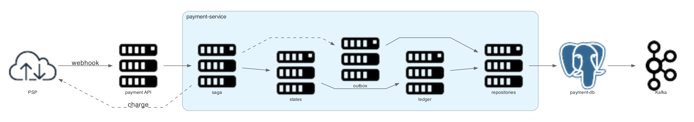

# payment-service

Owns the payment lifecycle from order to capture, the double-entry ledger, refunds, disputes, and inbound processor callbacks.



## Scope

| In scope | Out of scope |
|---|---|
| Order creation and cancellation | Settlement execution |
| Authorization and capture | Merchant bank details |
| Refunds and partial refunds | Card storage |
| Disputes and evidence | Merchant webhook delivery |
| Ledger posting | Reporting UI |
| Inbound PSP webhook handling | Outbound merchant notifications |

Entry point: `payment-service/src/main/java/com/snehal/neopay/payment/`.

## API

| Method and path | Purpose | Idempotent |
|---|---|---|
| `POST /v1/orders` | Create an order | No |
| `POST /v1/payments` | Initiate a payment attempt | Yes, `X-Idempotency-Key` |
| `POST /v1/payments/{id}/capture` | Capture an authorized payment | Yes, by state |
| `POST /v1/payments/{id}/refunds` | Create a refund | Yes, `X-Idempotency-Key` |
| `GET /v1/payments/{id}/refunds` | List refunds | Not applicable |
| `POST /v1/payments/{pid}/disputes` | Open a dispute | No |
| `GET /v1/payments/{pid}/disputes` | List disputes | Not applicable |
| `POST /v1/payments/{pid}/disputes/{did}/evidence` | Upload evidence | Yes, external evidence id |
| `POST /v1/payments/{pid}/disputes/{did}/represent` | File representment | No |
| `POST /v1/payments/{pid}/disputes/{did}/resolve` | Close as `WON` or `LOST` | No |
| `POST /webhook/stripe` | Processor callback | Yes, event id |
| `GET /internal/payments/unsettled-captured` | Settlement input | Not applicable |
| `POST /internal/payments/mark-settled` | Mark payments settled | No |
| `POST /internal/ledger/**` | Settlement and payout postings | Yes, transaction key |

Request shapes follow the DTO records in `payment-service/src/main/java/com/snehal/neopay/payment/dto/`.

```json
POST /v1/payments
{
  "orderId": "0f8b1c2e-...",
  "method": "UPI",
  "methodDetails": { "vpa": "customer@okaxis" }
}
```

## Internal flow

1. `PaymentAuthorizationRecorder` locks the order row, validates status and expiry, enforces risk, and inserts the payment.
2. The state machine moves `CREATED -> AUTHORIZING` and writes a transition log plus a domain event.
3. `PaymentGatewayRouter` selects an adapter or processor by method and calls the processor boundary.
4. A synchronous result authorizes and captures; an asynchronous result arrives on the webhook endpoint.
5. Capture posts one balanced ledger pair and marks the order paid.
6. Every state change publishes an outbox event in the same transaction.

## State machine

| From | Event | To |
|---|---|---|
| `CREATED` | `AUTHORIZE_ATTEMPT` | `AUTHORIZING` |
| `AUTHORIZING` | `AUTHORIZE_SUCCESS` | `AUTHORIZED` |
| `AUTHORIZING` | `AUTHORIZE_FAIL` | `FAILED` |
| `AUTHORIZED` | `CAPTURE_REQUEST` | `CAPTURING` |
| `CAPTURING` | `CAPTURE_SUCCESS` | `CAPTURED` |
| `CAPTURING` | `CAPTURE_FAIL` | `AUTHORIZED` |
| `CAPTURED` | `REFUND_INIT` | `PARTIALLY_REFUNDED` |
| `CAPTURED` or `PARTIALLY_REFUNDED` | `SETTLE` | `SETTLED` |

Source: `payment-service/src/main/java/com/snehal/neopay/payment/statemachine/PaymentStateMachine.java`.

## Resilience

| Dependency | Failure handling |
|---|---|
| Merchant risk call | Circuit breaker fails open; counter incremented |
| Vault | Circuit breaker; card charge fails, other methods continue |
| Processor | Exception triggers compensation to `FAILED`; no orphaned `AUTHORIZING` row |
| Postgres | Transaction rollback; no partial posting |
| Kafka | Outbox retains events until the relay succeeds |
| Redis | Idempotency marker unavailable; database uniqueness still blocks duplicates |

## Error modes

| Code | Status | Cause |
|---|---|---|
| `ORDER_NOT_PAYABLE` | 400 | Order is paid or cancelled |
| `ORDER_EXPIRED` | 400 | `expiresAt` passed |
| `INVALID_STATE_TRANSITION` | 409 | Event not allowed from the current status |
| `IDEMPOTENCY_CONFLICT` | 409 | Same key, different payload |
| `PAYMENT_NOT_DISPUTABLE` | 400 | Status not captured or settled |
| `DISPUTE_EXCEEDS_CAPTURED` | 400 | Dispute amount above the payment |
| `EVIDENCE_WINDOW_CLOSED` | 400 | Evidence after the deadline |
| `EVIDENCE_NOT_SUBMITTED` | 400 | Representment without evidence |
| `WEBHOOK_SIGNATURE_INVALID` | 400 | HMAC mismatch |

## Diagram script

```python
import os
import sys

sys.path.insert(0, os.path.join(os.path.dirname(__file__), ".."))
from _style import GRAPH_ATTR, NODE_ATTR, EDGE_ATTR, node

from diagrams import Diagram, Cluster, Edge
from diagrams.onprem.compute import Server
from diagrams.onprem.database import PostgreSQL
from diagrams.onprem.network import Internet
from diagrams.onprem.queue import Kafka

G = dict(GRAPH_ATTR)
G.update({"splines": "polyline", "ranksep": "0.75"})

with Diagram("", show=False, direction="LR", graph_attr=G,
             node_attr=NODE_ATTR, edge_attr=EDGE_ATTR,
             filename="./docs/assets/service_payment_flow", outformat="png"):
    psp = node(Internet, "PSP")
    api = node(Server, "payment API")
    with Cluster("payment-service", graph_attr={"margin": "18", "fontsize": "11", "labeljust": "l"}):
        saga = node(Server, "saga")
        state = node(Server, "states")
        ledger = node(Server, "ledger")
        repo = node(Server, "repositories")
        outbox = node(Server, "outbox")
    db = node(PostgreSQL, "payment-db")
    bus = node(Kafka, "Kafka")

    psp >> Edge(label="webhook") >> api >> saga >> state >> ledger >> repo >> db >> bus
    saga >> Edge(style="dashed") >> outbox
    outbox >> repo
    saga >> Edge(label="charge", style="dashed", constraint="false") >> psp
```

Related: [webhooks](../WEBHOOKS.md), [chargebacks](../CHARGEBACKS.md), [saga](../03_patterns/01_saga_orchestration.md), [idempotency](../03_patterns/03_idempotency.md).
