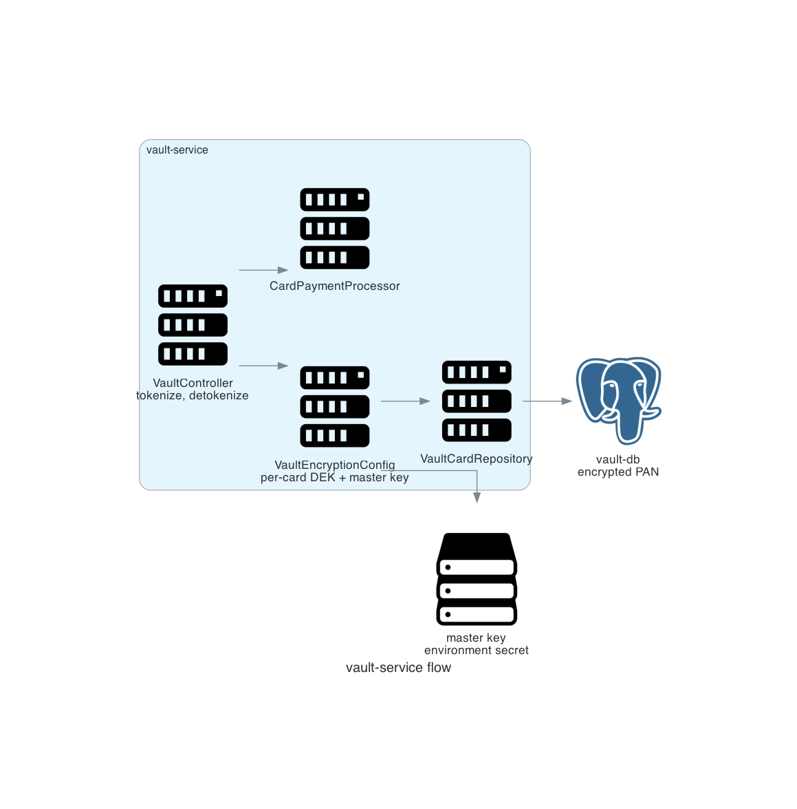

# vault-service

Stores card data in encrypted form and issues tokens. It is the only service that handles a PAN.

<p align="center"></p>

## Scope

| In scope | Out of scope |
|---|---|
| PAN encryption and token issuance | Payment authorization |
| Detokenization for a charge | Key escrow |
| BIN, last four, brand derivation | Card network connectivity |
| Token lookup | Fraud scoring |

Entry point: `vault-service/src/main/java/com/snehal/neopay/vault/`.

## API

| Method and path | Purpose |
|---|---|
| `POST /v1/vault/tokens` | Tokenize a card, returns `tok_...` plus last four and brand |
| `POST /v1/vault/charge` | Detokenize and forward a charge to the card processor |

## Key handling

| Material | Storage |
|---|---|
| Per-card data key | Wrapped by the master key, stored with the card row |
| Master key | Environment secret `VAULT_MASTER_KEY` |
| PAN | Ciphertext in `vault_card.encrypted_pan` |
| Token | `card_token` row, opaque |

Source: `vault-service/src/main/java/com/snehal/neopay/vault/config/VaultEncryptionConfig.java`.

## Internal flow

1. The request arrives with a PAN, expiry, and cardholder name.
2. The service derives BIN, last four, and brand, generates a data key, and encrypts the PAN.
3. It persists the card and returns a token.
4. For a charge, it loads the card, decrypts the PAN into a byte array, calls the processor, and zero-fills the array.

## Resilience and error modes

| Condition | Result |
|---|---|
| Processor declines | Failure with the processor code |
| Decryption failure | Charge aborted; no PAN emitted |
| Unknown token | `404` |
| Master key missing | Service fails to start |

Callers treat vault as non-critical for non-card methods: `payment-service` wraps the call in a circuit breaker, so UPI and netbanking continue when the vault is down.

## Diagram script

```python
import os
import sys

sys.path.insert(0, os.path.join(os.path.dirname(__file__), ".."))
from _style import GRAPH_ATTR, NODE_ATTR, EDGE_ATTR, node

from diagrams import Diagram, Edge
from diagrams.onprem.compute import Server
from diagrams.onprem.database import PostgreSQL
from diagrams.generic.storage import Storage

G = dict(GRAPH_ATTR)
G.update({"splines": "polyline"})

with Diagram("", show=False, direction="LR", graph_attr=G,
             node_attr=NODE_ATTR, edge_attr=EDGE_ATTR,
             filename="./docs/assets/service_vault_flow", outformat="png"):
    api = node(Server, "vault API")
    crypto = node(Server, "crypto")
    processor = node(Server, "card processor")
    repo = node(Server, "repositories")
    db = node(PostgreSQL, "vault-db")
    key = node(Storage, "master key")

    api >> crypto
    crypto >> repo >> db
    crypto >> Edge(style="dashed", label="unwrap") >> key
    api >> processor
```

Related: [PCI scope](../PCI_SCOPE.md), [ADR 0006](../adr/0006-tokenization-for-pci-scope.md).
