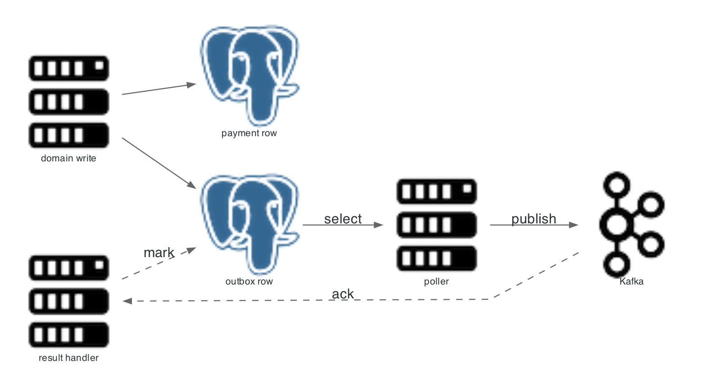

# Transactional outbox

Domain events are written in the same database transaction as the state change, then relayed to Kafka by a poller. There is no dual write between Postgres and Kafka.

<p align="center"></p>

Diagram source: `docs/assets/scripts/03_outbox_pattern.py`.

## Write path

| Step | Action |
|---:|---|
| 1 | The service saves the aggregate row |
| 2 | `OutboxEventPublisher` inserts `outbox_event` with status `PENDING` in the same transaction |
| 3 | The transaction commits; both rows exist or neither does |

Source: `payment-service/src/main/java/com/snehal/neopay/payment/outbox/OutboxEventPublisher.java`.

## Relay path

| Step | Action |
|---:|---|
| 1 | `OutboxPoller` runs under a ShedLock lease, `lockAtMostFor` 1 minute |
| 2 | It selects `PENDING` rows ordered by creation |
| 3 | It publishes to the topic chosen from the aggregate type |
| 4 | `OutboxResultHandler` marks the row `PUBLISHED` or increments attempts |
| 5 | After the third failure the row becomes `FAILED` with the error text |

Topic defaults: `payments.events`, `orders.events`, `refunds.events`, `settlements.events`.

## Delivery guarantee

| Property | Value |
|---|---|
| Guarantee | At least once |
| Duplicate risk | A crash after publish and before the status update re-sends the event |
| Consumer requirement | Deduplicate on event id or a business key |
| Ordering | Per aggregate only in practice; not enforced across partitions |

## Failure states

| Status | Meaning | Recovery |
|---|---|---|
| `PENDING` | Awaiting relay | Automatic |
| `PUBLISHED` | Delivered to Kafka | None |
| `FAILED` | Three attempts failed | Operator inspects the error and resets to `PENDING` |

Runbook entry: [outbox stalled](../runbook.md).

## Why not CDC

| Option | Benefit | Cost |
|---|---|---|
| Polling relay (used) | No extra infrastructure; simple to test | Latency equals the poll interval; extra reads |
| Debezium | Lower latency; no application polling | Connector deployment, schema coupling, another failure domain |

## Evidence

| Check | Result |
|---|---|
| Chaos, Kafka stopped for 20 s | 476 pending rows, drained to zero within 20 s after restart |
| Chaos, Postgres stopped for 20 s | 155 pending rows, drained to zero within 30 s |
| Duplicate captures during both | Zero |

Measurements: [CHAOS](../CHAOS.md).

Related: [payment service](../02_services/payment_service.md), [resilience](04_resilience_circuit_breakers.md).

## Diagram script

```python
import os
import sys

sys.path.insert(0, os.path.dirname(__file__))
from _style import GRAPH_ATTR, NODE_ATTR, EDGE_ATTR, node

from diagrams import Diagram, Edge
from diagrams.onprem.database import PostgreSQL
from diagrams.onprem.queue import Kafka
from diagrams.onprem.compute import Server

G = dict(GRAPH_ATTR)
G.update({"splines": "polyline"})

with Diagram("", show=False, direction="LR", graph_attr=G,
             node_attr=NODE_ATTR, edge_attr=EDGE_ATTR,
             filename="./docs/assets/03_outbox_pattern", outformat="png"):
    write = node(Server, "domain write")
    payment = node(PostgreSQL, "payment row")
    outbox = node(PostgreSQL, "outbox row")
    poller = node(Server, "poller")
    bus = node(Kafka, "Kafka")
    result = node(Server, "result handler")

    write >> payment
    write >> outbox
    outbox >> Edge(label="select") >> poller >> Edge(label="publish") >> bus
    bus >> Edge(style="dashed", label="ack", constraint="false") >> result
    result >> Edge(style="dashed", label="mark", constraint="false") >> outbox
```
