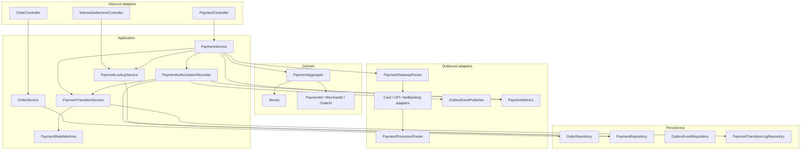

# C4 — Components: payment-service

## Component rules

| Rule | Enforcement |
|---|---|
| Controller → service only | ArchUnit |
| Repository never depends on service | ArchUnit |
| Entity never depends on web or repository | ArchUnit |
| No `@Autowired` field injection | ArchUnit |
| At most five parameters per method | ArchUnit |
| No package cycles | ArchUnit |
