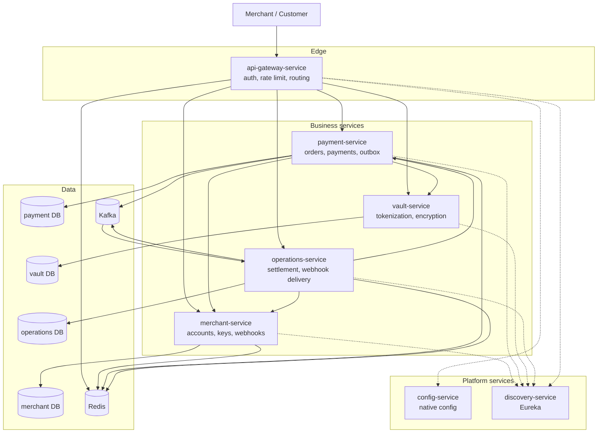

# C4  -  Containers

## Container responsibilities

| Container | Port | Owns | Scaling unit |
|---|---:|---|---|
| `api-gateway-service` | 8080 | Authentication, rate limiting, routing | Stateless |
| `merchant-service` | 9010 | Merchants, users, customers, API keys, webhook targets | Stateless |
| `payment-service` | 9020 | Orders, payments, outbox, processors | Stateless |
| `vault-service` | 9040 | Cards, tokens, encryption | Stateless |
| `operations-service` | 9030 | Settlements, webhook delivery, DLQ | Stateless |
| `config-service` | 8888 | Central configuration | Stateless |
| `discovery-service` | 8761 | Service registry | Stateless |

All state lives in Postgres, Redis or Kafka. No container holds authoritative state in
memory, which is the precondition for horizontal scaling.
