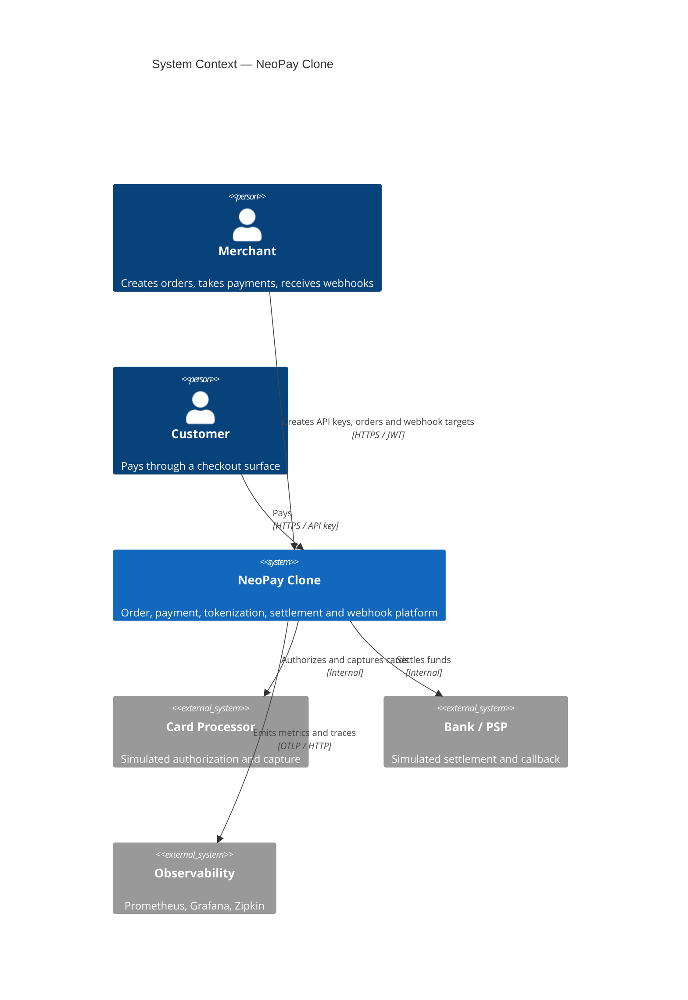

# C4 — System Context

## Actors

| Actor | Responsibility |
|---|---|
| Merchant | Owns an account, API keys and webhook targets |
| Customer | Supplies payment credentials through a checkout surface |
| Operator | Reads dashboards, runbooks and reconciliation breaks |

## External systems

Card processor, bank/PSP and UPI switch are simulated. No real network, settlement
window or ISO 8583/20022 message is exchanged.
